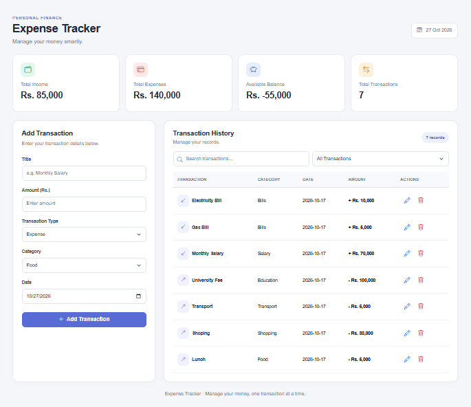
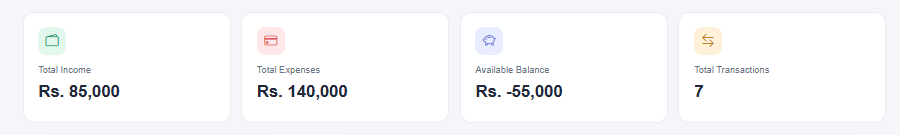
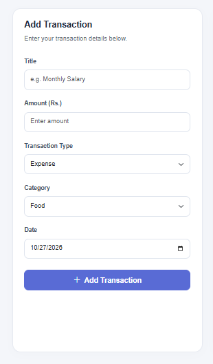
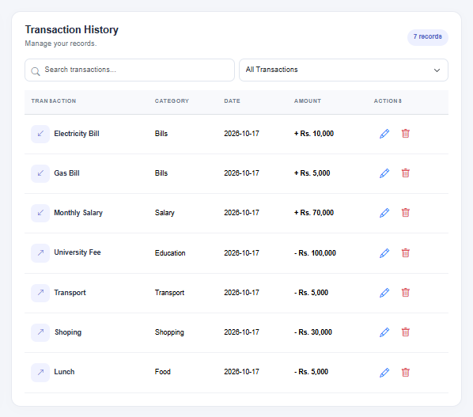

## Expense Tracker

A responsive web application built with HTML, CSS, Bootstrap 5, and JavaScript to manage daily income and expenses easily.

## Live Demo

https://expense-tracker-plum-xi-98.vercel.app/

## Screenshots

<table>
   <tr>
     <td align="center"><b>Dashboard</b> </td>
     <td align="center"><b>Dashboard Calculations</b> </td>
   </tr>
   <tr>
     <td align="center"><b>Add Transactions</b> </td>
     <td align="center"><b>Transaction History</b>    </td>
   </tr>
</table>

## Features

* Add income and expense transactions.
* Edit and delete transactions.
* Automatically calculate total income, expenses, and available balance.
* Display total number of transactions.
* Search transactions by title or category.
* Filter transactions by income and expense.
* Save transaction data using Local Storage.
* Responsive design for mobile, tablet, and desktop screens.

## Technologies Used

* HTML5
* CSS3
* Bootstrap 5
* JavaScript
* Local Storage

## Author

Laiba Fatima

